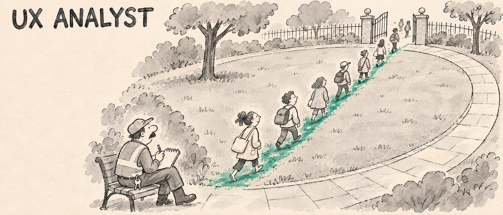
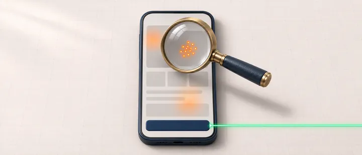

<p align="center">
  
</p>

# UX Analyst

A Claude Code skill that runs a UI/UX audit of a site from Microsoft Clarity data.

[](LICENSE)

[Use cases](#use-cases) | [Why it is built this way](#why-it-is-built-this-way) | [Installation](#installation) | [Usage](#usage) | [License](#license)

The skill ranks pages by friction through the official Clarity MCP, reads click maps, scroll maps, dead and rage taps and the Copilot heatmap summary in the Clarity UI, checks each page against the live site and its funnel step, and writes findings you can hand to a designer or developer: the element, what users do, the evidence, the fix and a priority.

## Use cases


### Find where to look first

You ask: "Audit our store in Clarity." The skill pulls sessions, dead clicks, rage clicks, quickbacks and scroll depth per page and device, computes friction rates itself and weighs them by what each page is worth. You get three to five pages with one line on why each was picked, and, when a funnel source is connected, each page's funnel step next to its friction numbers.

<br clear="all">



### Explain a dead-tap cluster

You ask: "Why do mobile users keep tapping the product photo?" The skill reads the click list and the dead-tap view in the Clarity UI, matches selectors with the live page at 375 px and finds that the product photo looks tappable but is not. You get the selector, its tap count and share of the page's taps, the conversion of sessions that tapped it when Clarity has a conversion segment, and a fix with a priority.

<br clear="all">


### Check whether the CTA is seen

You ask: "Is the lead form too far down?" The skill takes the 50% and 25% reach lines from Clarity's scroll data for mobile and desktop and places the form by its measured position on the live page. You get whether it sits above the 50% or the 25% reach line on each device, and where to move it.

<br clear="all">

## Why it is built this way

- Clarity has no heatmap API. The MCP answers dashboard questions such as sessions, dead clicks, rage clicks and scroll depth, while click and scroll maps are only in the UI. The skill uses both and reads the UI through a browser tool.
- Pages are ranked by business weight × friction rate per session, not by raw counts, so a busy blog post does not outrank a checkout with a broken button.
- A page that looks bad on heatmaps but converts as well as its peers is reported as such. The funnel step from GA4, Amplitude or Mixpanel is the judge.
- Copilot's heatmap summary is treated as a hypothesis to check. It can miss the largest dead-tap cluster on a page.
- Rates are computed from counts. Asked for a percentage, the Clarity MCP can return different numbers for the same page from one query to the next.
- PII is handled conservatively. Balanced masking hides digits but not letters, so elements are named by selector, and sites with personal data in URLs get no raw URLs and no recordings.

## What you need

- Claude Code with the official [Microsoft Clarity MCP](https://github.com/microsoft/clarity-mcp-server) connected and signed in.
- A browser tool that can open the Clarity UI with your sign-in, such as Claude in Chrome.
- Optional: access to the site's product analytics (GA4, Amplitude, Mixpanel) for the funnel check.

## Installation

In Claude Code:

```text
/plugin marketplace add arcbaslow/ux-analyst
/plugin install ux-analyst@ux-analyst
```

From a shell: `claude plugin marketplace add arcbaslow/ux-analyst`, then `claude plugin install ux-analyst@ux-analyst`.

## Usage

```text
/ux-analyst:ux-analyst example.com checkout
```

Or ask in plain words: "audit the product pages in Clarity", "where do mobile users get stuck on the lead form". The skill picks three to five pages, works over the last 30 whole days, writes a Markdown report and posts the top three findings in chat.

## What it does not do

It never changes Clarity settings, smart events or your tag manager. It does not download CSV exports without asking, and it keeps recording links, session IDs and query strings out of the report.

## License

[MIT](LICENSE)
